# Домашнее задание «TeamCity»

## 1. Подготовка инфраструктуры

Для выполнения домашнего задания в Yandex Cloud были созданы три виртуальные машины:


TeamCity Server 
TeamCity Agent 
Nexus Repository

TeamCity Server и TeamCity Agent запущены с использованием Docker.

Агент подключён к серверу TeamCity, авторизован и добавлен в пул `Default`.

### TeamCity Server

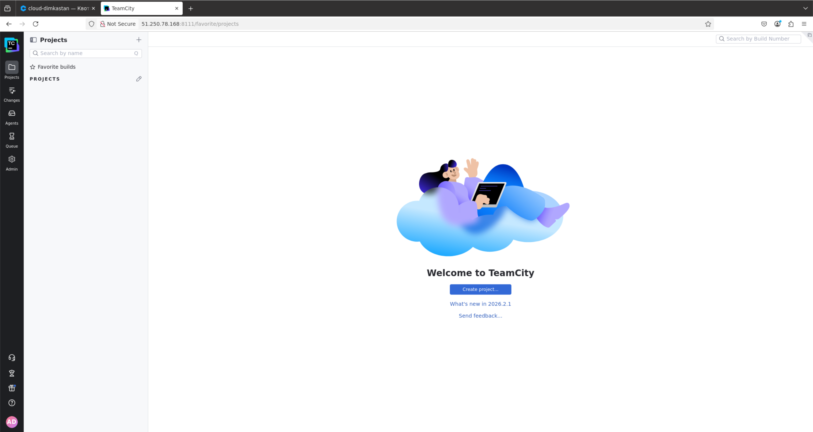

### Авторизованный TeamCity Agent

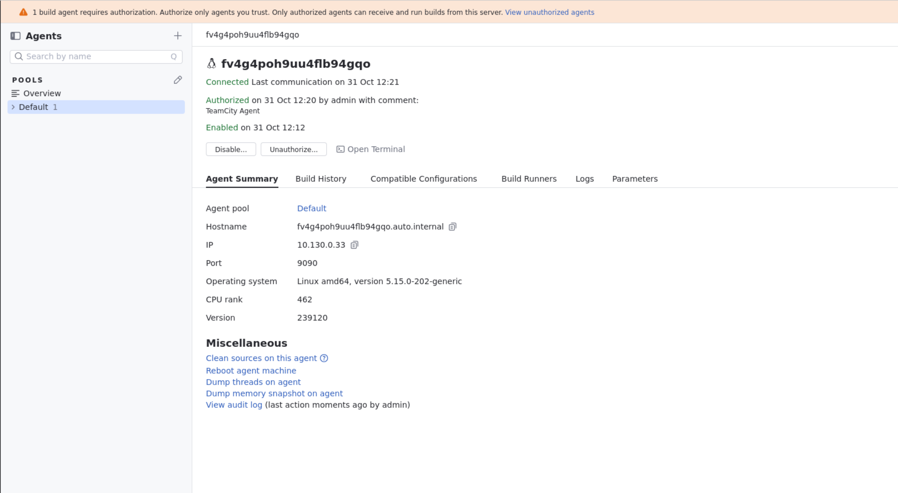

### Nexus Repository

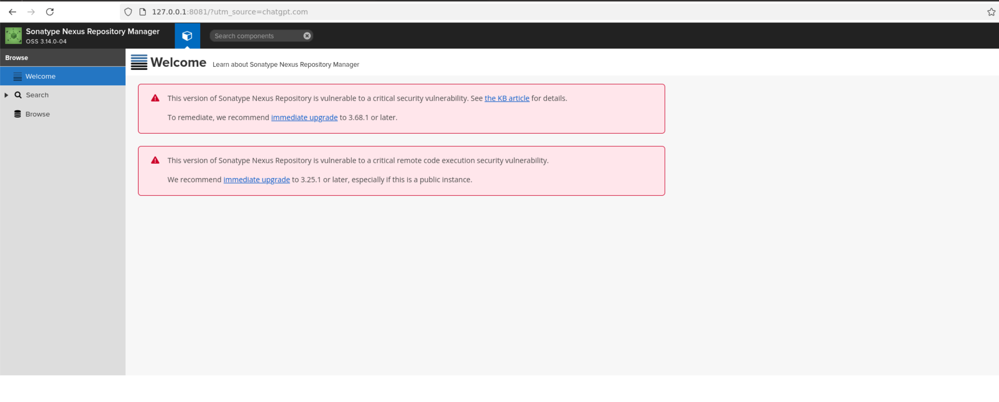

## 2. Создание проекта и первая сборка

Создан Fork репозитория:

https://github.com/S1ugger96/example-teamcity

В TeamCity создан проект `example-teamcity` и настроено подключение к GitHub через VCS Root.

Созданы Maven Build Steps и VCS Trigger для автоматического запуска сборок при изменении исходного кода.

Выполнена первая сборка ветки `master`.

**Результат:** Build #1 — `Success`, успешно пройдено 5 тестов.

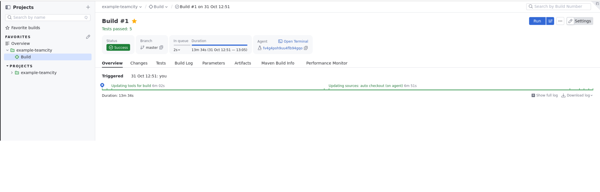

## 3. Настройка Maven и Nexus

Установлен Nexus Repository Manager, настроен Maven-репозиторий `maven-releases`.

В TeamCity загружен файл Maven Settings с учётными данными для публикации артефактов в Nexus.

В файле `pom.xml` изменён раздел `distributionManagement` для публикации в собственный Nexus Repository.

Настроены разные команды сборки в зависимости от ветки.

**Для master:**

```bash
mvn clean deploy
```

**Для остальных веток:**

```bash
mvn clean test
```

Выполнена успешная сборка с публикацией Maven-артефакта.

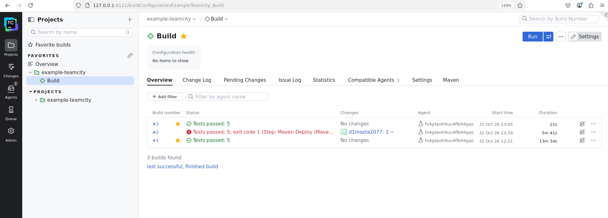

В Nexus опубликован артефакт:

- Group ID: `org.netology`
- Artifact ID: `plaindoll`
- Version: `0.0.2`
- Repository: `maven-releases`

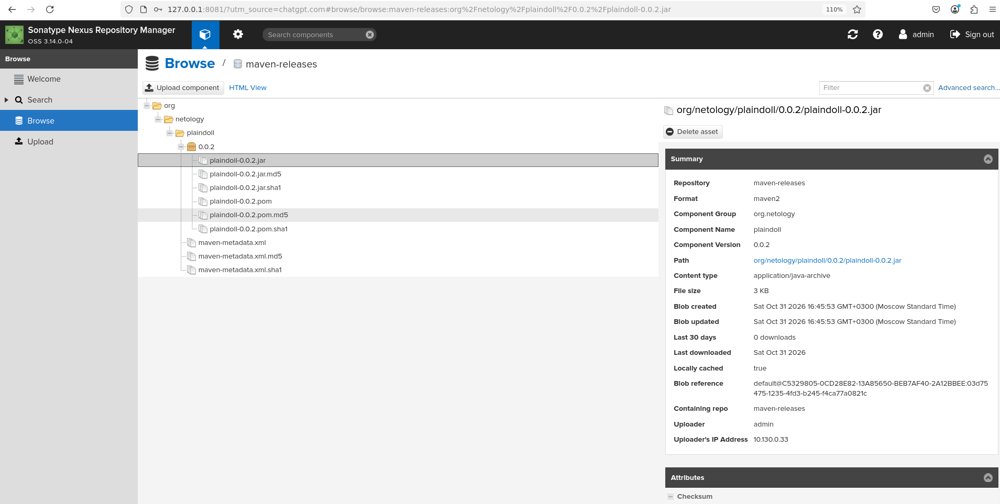

## 4. Versioned Settings и Kotlin DSL

Настроено хранение конфигурации TeamCity в GitHub.

Используется формат **Kotlin DSL**.

Конфигурация размещена в каталоге `.teamcity`:

- `.teamcity/settings.kts`
- `.teamcity/pom.xml`
- `.teamcity/pluginData/_Self/mavenSettings/`

Настроена синхронизация Versioned Settings с GitHub.

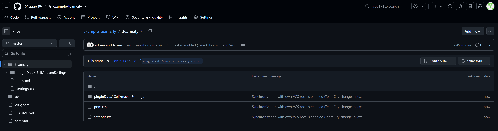

## 5. Создание feature-ветки и тестирование

Создана ветка:

`feature/add_reply`

В классе `Welcomer` добавлен метод:

```java
public String sayReply() {
    return "Hello again, hunter!";
}
```

В классе `WelcomerTest` добавлен тест:

```java
@Test
public void welcomerSaysReply() {
    assertThat(welcomer.sayReply(), containsString("hunter"));
}
```

Изменения отправлены в GitHub.

После отправки изменений TeamCity автоматически запустил сборку feature-ветки.

**Результат:** Build #5 — `Success`, успешно пройдено 6 тестов.

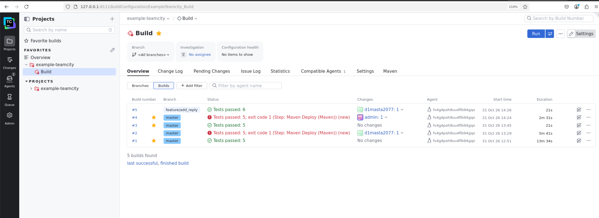

После успешного тестирования ветка `feature/add_reply` объединена с `master`.

## 6. Настройка публикации артефактов в TeamCity

После объединения веток выполнена сборка основной ветки.

До настройки Artifact Paths пользовательские JAR-артефакты в TeamCity отсутствовали.

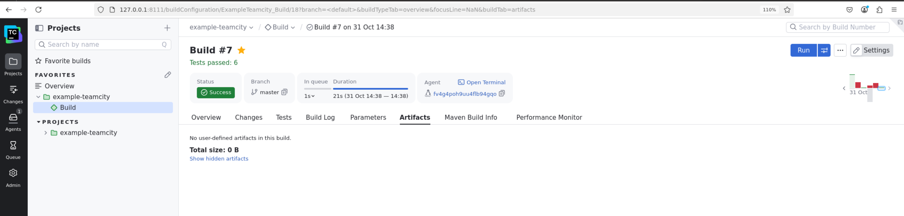

В настройках Build Configuration добавлено правило:

```text
target/*.jar => artifacts
```

После изменения конфигурации выполнена повторная сборка `master`.

**Результат:**

- Build #10 — `Success`
- Branch — `master`
- Tests passed — `6`
- Maven Deploy — выполнен успешно
- JAR-файлы опубликованы в TeamCity

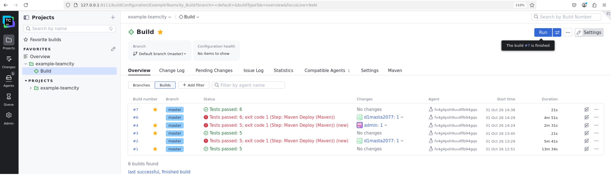

Во вкладке Artifacts появились файлы:

- `plaindoll-0.0.2.jar`
- `original-plaindoll-0.0.2.jar`

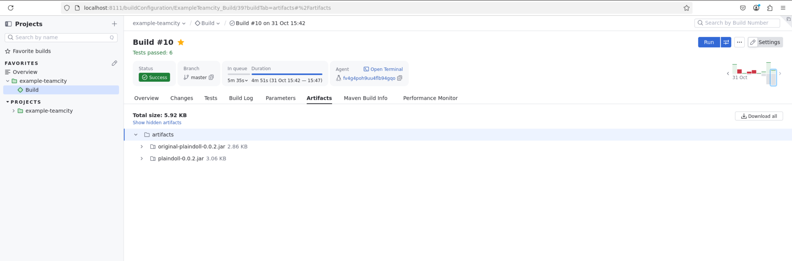


**Ссылка на репозиторий:**

https://github.com/S1ugger96/example-teamcity
